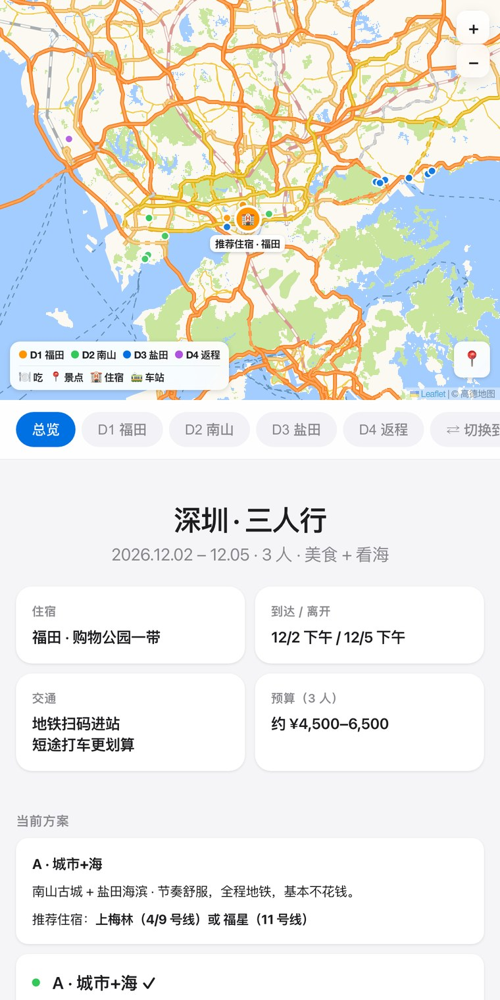
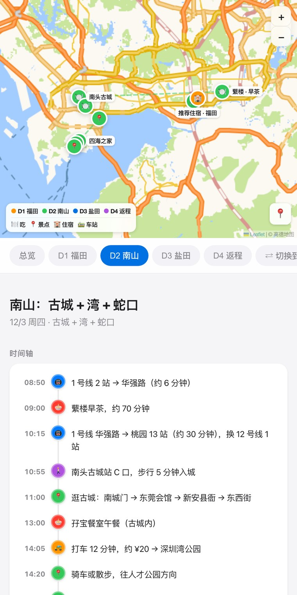
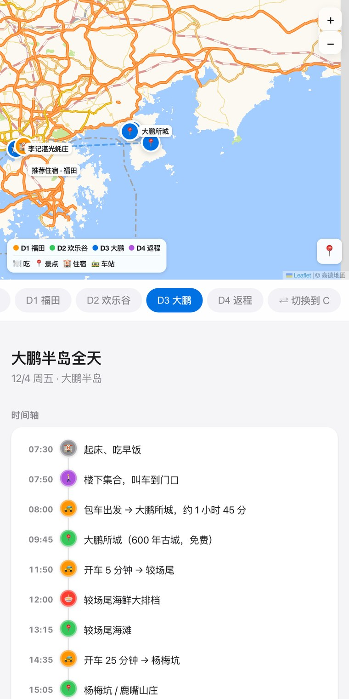

# Trip Map Builder

从零散信息到可部署的交互式行程地图页面。

三阶段流水线：**规划行程 → 大众点评/小红书调研 → 生成地图页面**。

定位：生成出发前的参考坐标，不是假装旅行会逐小时照做的执行脚本。

---

> **来源**：本仓库是 [hiyeshu/trip-map-builder](https://github.com/hiyeshu/trip-map-builder) 的修改版，基于上游 `195fff6` 分叉。
> 原始设计、代码与文档版权归原作者所有。上游未附带 LICENSE 文件，本仓库沿用上游的使用条件，未另行授权。

## 效果

<p align="center">
  
  
  
</p>

截图来自一次真实的深圳三人行（3.5 天，三个方案）。

- **左 · 总览** — 三个方案卡片可切换，地图上是全城点位，左下角图例区分路线颜色和点位类型；下方是当前方案摘要、推荐住宿和穿衣建议。
- **中 · 单日** — 分钟级时间轴：时间列 + 分类色节点 + 竖向连线。地图上每个点常驻名称标签，密集区域自动避让。
- **右 · 方案切换** — 换到 B 方案后，图例、路线颜色、标签一起更新，D3 从盐田变成大鹏半岛，路线从地铁改成包车。

## 改了什么

起因是一次真实的深圳三人行：3.5 天、三人、想吃想逛。按原版流程跑完后发现五个缺口——只出了一个方案、没有具体时间点、没有住宿和穿衣建议、大众点评打不开时没法降级、地图点开只有一堆没有名字的圆点。以下改动针对这五点。

| 文件 | 改动 |
|---|---|
| `SKILL.md` | Phase 1 核心步骤由 7 步扩为 11 步（增加预算、分钟级时间轴、住宿推荐、天气穿衣、多方案）；新增「多方案」「时间轴」「住宿」「天气与穿衣」「地图必须真的能用」五节；Phase 2 增加大众点评登录墙下的降级路径；Phase 3 补充 `steps` / `PLANS` 数据结构和交付前自查；`description` 补入「多方案」「住宿推荐」「穿衣建议」触发词 |
| `references/trip-planning.md` | 新增约 140 行：多方案的变体轴与 4-beat 询问模板、时间轴的三条硬规则与反例、住宿预算口径拆解、天气取数与分场景穿衣清单 |
| `references/map-quality.md` | **新增文件**。境内可达的高德高清瓦片、WGS-84 → GCJ-02 转换函数、图例与常驻名称标签、标签碰撞避让、切换方案时清理残留 tooltip、视觉化时间轴的数据结构与样式、交付前自查表 |
| `references/dianping-research.md` | 新增登录墙识别、小红书逐店检索的搜索词写法、标题信号强弱判断、五维提取（人均/必点/缺点/排队/定位）、负面信息保留原则 |
| `README.md`、`CLAUDE.md` | 同步目录结构、流程步骤和新文件索引 |

上游原有的三阶段框架、`assets/template.html` 模板、共享记忆机制均未改动。

## 修正的实际问题

| 问题 | 处理 |
|---|---|
| CartoDB / OSM 瓦片在境内直接超时（`curl` 返回 `000`），页面只剩 "API KEY REQUIRED" 占位 | 改用高德瓦片 |
| 256px 瓦片在 Retina 屏被放大两倍，地图发糊 | 请求 512px（`scl=2`），渲染仍是 256 CSS px |
| 高德使用 GCJ-02，不转换会让所有点位整体偏移 300–600 米 | 加入转换函数；绘制用 GCJ-02，导航链接仍用 WGS-84 |
| 切换方案后 `map.removeLayer()` 带不走 permanent tooltip，旧标签残留 | 显式追踪 tooltip 并清理，酒店标签单独保留 |
| 大众点评网页端与 m 站均强制跳登录，取不到评分 | 改为按店名逐家检索小红书，保留负面评价 |

如需上游原始版本，请访问 [hiyeshu/trip-map-builder](https://github.com/hiyeshu/trip-map-builder)。

---

## 共享记忆

技能会优先读取 `~/.trip-map-builder/MEMORY.md`，复用长期有效的旅行偏好：节奏、餐饮、预算、支付、导航方式、历史行程输出和未解决事项。它不保存原始截图、证件、订单号或完整聊天记录。

## Demo

**[tokyo-trip-pi.vercel.app](https://tokyo-trip-pi.vercel.app)** — 东京 4 泊 5 日行程地图

源码：[hiyeshu/tokyo-trip](https://github.com/hiyeshu/tokyo-trip)

## 这个技能做什么

给 AI agent 一套完整的旅行规划工作流：

1. 用户丢过来机票截图、酒店截图、想去的地方
2. Agent 提取硬约束（日期、航班、酒店位置、预算），按区域分组，主动删掉塞不下的点，并标记天气敏感点
3. **一次给 2–3 个方案**（城市线 / 远郊线 / 纯市区），每个写清差异、预算、最早起床时间和推荐住宿，让用户选
4. 每天排一条**分钟级时间轴**：几点出门、坐哪条线几站、几点到、几点走、花多少钱
5. 餐厅按当天区域给候选，用大众点评 + 小红书判断口味、排队、踩雷、氛围和近期体验；大众点评登录墙打不开时，自动转小红书逐店检索
6. 给住宿区域推荐：先拆清预算口径，再给贴地铁的 2–3 个片区和各自缺点
7. 查实况天气，给分场景的穿衣清单
8. 生成单文件 HTML 页面：Leaflet 地图（境内可达的高清底图 + 图例 + 常驻名称标签）+ 视觉化时间轴 + 方案切换 + 高德导航 + 小红书链接 + 支付方式标签
9. 更新共享记忆，只保存下次旅行仍然有用的偏好和输出索引
10. 推到 GitHub，Vercel 自动部署，手机打开直接用

## 安装

一行命令安装（[skills.sh](https://skills.sh) 生态）：

```bash
npx skills add WessonZZ/trip-map-builder-more
```

或者手动 clone 到 skills 目录：

```bash
# Cursor
git clone https://github.com/WessonZZ/trip-map-builder-more.git ~/.cursor/skills/trip-map-builder

# Claude Code
git clone https://github.com/WessonZZ/trip-map-builder-more.git ~/.claude/skills/trip-map-builder
```

## 触发词

说这些话会激活技能：

- "做个行程" / "行程规划" / "行程地图"
- "plan my trip" / "trip map" / "build itinerary"
- "帮我查一下小红书上这家店怎么样"

## 工作流

### Phase 1：规划行程

从用户给的碎片信息里抽出硬约束，按区域分组，主动删高风险点。

核心原则：
- 一天一个主区域
- 不是越满越好，是越顺越好
- 行程是参考坐标，真实执行可以被天气、当前位置、体力和饥饿程度覆盖
- 餐厅是当天区域内的顺路候选，不为名店反向扭曲路线
- 替用户删东西，说清楚删了什么、为什么删

详见 [`references/trip-planning.md`](references/trip-planning.md)

### Phase 2：大众点评 + 小红书调研

餐厅优先看大众点评和小红书：大众点评判断口味、排队、踩雷、值不值得；小红书补氛围、近期体验、拍照和软性提醒。

小红书可用 OpenCLI 的 CDPBridge 连接 Chrome，直接访问搜索结果页路由，拦截 `search/notes` API，提取前排笔记。

关键经验：**不要模拟输入框**，直接进 `search_result?keyword=` 路由更稳定。

两段式流程：先粗筛搜索结果（10-20 条），再精读最相关的 2-3 条详情页。

详见 [`references/dianping-research.md`](references/dianping-research.md) 和 [`references/xhs-research.md`](references/xhs-research.md)

### Phase 3：生成地图页面

基于 [`assets/template.html`](assets/template.html) 模板填入数据，生成单文件 HTML：

- Leaflet.js 交互地图（无需 API key）
- 按天切换的时间轴卡片
- 每个地点：
  - 📍 **导航**：Action Sheet 三选——Apple Maps / Google Maps / 🧭 **高德地图 App**（直接 scheme 唤起，不打开网页）
  - 📕 **小红书 App**：UA 检测，正常浏览器走 `xhsdiscover://` scheme，微信/抖音等 WebView 内自动降级到 m 站
  - 🍜 **大众点评 App**：`food` / `drink` 类型自动启用，可用 `dianping: false` 关闭，或 `dianpingKeyword` 自定义搜索词
  - 📅 预约按钮（可选）
- 支付方式标签（信用卡 / 支付宝 / 交通卡 / 现金）
- 默认 Apple 设计系统，可通过 [awesome-design-md](https://github.com/VoltAgent/awesome-design-md) 切换风格

## 依赖

| 工具 | 用途 | 安装 |
|------|------|------|
| [OpenCLI](https://github.com/jackwener/OpenCLI) | 大众点评 adapter + 小红书调研 | `npm install -g @jackwener/opencli` |
| Chrome / Chromium | 浏览器 + 远程调试 | — |
| [Leaflet.js](https://leafletjs.com) | 地图渲染 | CDN 引入，无需安装 |
| [gh CLI](https://cli.github.com) | GitHub 仓库创建（可选） | `brew install gh` |

## 目录结构

```
trip-map-builder/
├── CLAUDE.md                 # 项目地图，记录目录职责
├── SKILL.md                  # 技能入口，三阶段流程
├── README.md                 # 本文件
├── assets/
│   └── template.html         # 可复用 HTML 地图模板
└── references/
    ├── CLAUDE.md             # references 局部地图
    ├── trip-planning.md      # 行程规划方法论
    ├── dianping-research.md  # 大众点评调研 + OpenCLI adapter
    └── xhs-research.md       # 小红书调研 + OpenCLI 安装
```

## 许可

MIT
